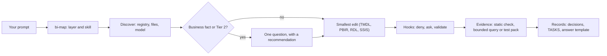

# analytics-agent-harness

**analytics-agent-harness** is a set of plain files you install into your BI repository so that a coding agent,
Claude Code first, works on **Power BI projects** (semantic models in TMDL, reports in PBIR), **Analysis Services
tabular models** (TMDL), **paginated reports** (RDL for SSRS, Report Server and the Power BI service) and the **SSIS
packages** that load them, as reviewable text, with evidence for every change. GitHub Copilot, Cursor, Gemini CLI and
OpenAI Codex can read the same files (see [Which AI agent](#which-ai-agent)). The installed pack keeps the internal
name `bi-agent-harness` (the installer path, the manifest file `.claude/bi-agent-harness.json` and the skill names keep
it). A later version is planned to add further domains under `domains/` without changing any installed path.

## Why use it

A coding agent already writes DAX, TMDL and RDL. What it does not do on its own is work the way a BI team needs:
change the smallest thing, prove a number by running it, stop before a rename or a new source, ask one question
instead of guessing a business rule, and leave a record the next person can read. Our A/B eval found the same
correctness as bare Claude and a safer, better documented process; adopt it for that, not for "better DAX"
([FAQ](docs/harness/faq.md#why-use-the-harness-and-what-it-does-not-promise)).



## What it does, and never does

- **Evidence before "done".** A static check after every batch of edits; a measure is proven by running it: a bounded
  DAX query through the Power BI modeling MCP server (Path A), or a test pack you run in Power BI Desktop (Path B).
  A check that did not run is reported as "not run", never as passed.
- **One question per turn.** The agent asks only for a decision the files cannot answer, with its recommendation,
  and proceeds on stated defaults for everything else, recorded in `docs/decisions.md`.
- **Tier 2 approvals.** Renames and deletes, relationships, RLS, data sources and the rest of the Tier 2 list in
  `AGENTS.md` (Editing boundaries) wait for your yes after the impact is shown.
- **Never:** deploy, publish, refresh a shared model, handle credentials, manage RLS or OLS membership, force push,
  disable hooks, change data in your databases, run SQL or MDX on its own. It gives you the steps instead
  ([Defaults you should know](#defaults-you-should-know): the SQL read switch decides what a query you ask for may do).

## Who downloads what

| Role | What to get | From |
|---|---|---|
| The person who installs the harness into a team repository (a solo developer: this row and the next) | this repository (clone or zip, outside the BI repository), Git, Node.js 18.17+ to run the installer and the optional hardening pack | GitHub, nodejs.org |
| The BI developer who uses Claude Code | a Claude Code that reads `AGENTS.md` ([versions](docs/harness/faq.md#versions-we-tested)); Power BI Desktop for PBIP work; the tools of the artifacts you work on (table below) | Anthropic, Microsoft |
| Teammates who only clone the repository | nothing to download: the harness is committed in the repository. They need the same Claude Code (or the `@AGENTS.md` line in a `CLAUDE.md`), and their own `.mcp.json` if they use MCP (it is not committed). With the hardening pack: Node.js 18.17+ on PATH, `git config core.hooksPath hardening/githooks` once per clone, and the Claude Code hooks either committed by the installer's owner (`--enable-hooks --shared`, recommended for a team) or registered by each person on their own machine (`--update --enable-hooks`, `.claude/settings.local.json`), which needs a clone of this repository: the installed copy's installer does not run | nodejs.org (and this repository for the per-machine hooks) |
| CI | Node.js 18.17+; the workflow template `hardening/ci/bi-validate.yml` | this repository |
| GitHub Copilot users (VS Code, CLI, cloud agent) | nothing from here: the files, the `bi-expert` agent and the hook registrations are committed; VS Code users enable the setting `chat.useHooks`; Copilot CLI users trust the folder in the CLI, start it with `--allow-all-tools` and keep the harness mode `auto`; see [Which AI agent](#which-ai-agent) | |
| Cursor, Gemini or Codex users | nothing from here: the knowledge files are in the repository; the hooks do not run there (Git hooks, CI and review are the net); not tested by us | |

| Tool | Required? | For | Where from |
|---|---|---|---|
| Claude Code | yes, for the agent | everything below | [code.claude.com](https://code.claude.com/docs/en/overview) |
| Git | yes | the repository, the Git hooks | git-scm.com |
| Node.js 18.17+ | for the installer and the hardening pack (hooks run `node`) | `install-into.mjs`, hooks, validator, CI | nodejs.org |
| Power BI Desktop | for PBIP work | opening and refreshing the project, running test packs, "View as" for RLS | Microsoft Store or the Desktop installer |
| `powerbi-modeling` MCP server | optional (Path A) | live model metadata, bounded DAX tests, impersonation | `.mcp.example.json` (`npx @microsoft/powerbi-modeling-mcp`) |
| Microsoft Learn MCP server | optional | current documentation | `.mcp.example.json` (HTTP) |
| `powerbi-report-author` (npm, Microsoft) | optional | PBIR property catalog and `validate` | npm |
| `powerbi-desktop` (npm, Microsoft) | optional | Desktop status, reload and screenshots with your approval | npm |
| Report Builder | for paginated reports | running an RDL, the parameter checks | Microsoft |
| SSMS or DAX Studio | for Analysis Services | running a test pack against a deployed model | Microsoft, daxstudio.org |
| Visual Studio with SSIS projects | for SSIS | `dtexec /Validate`, running packages | Microsoft |

**With nothing but Claude Code and Git** you get the instructions, skills, agents, rules and docs (Path B): the agent
edits the files, runs the manual checklist and writes test packs for you to run. Without Node, copy `AGENTS.md`,
`TASKS.md`, `.claude/`, `docs/`, `templates/`, `THIRD_PARTY_NOTICES.md`, `.mcp.example.json` and `.gitattributes` by
hand (plus `.vscode/extensions.json` and, for GitHub Copilot, `.github/agents/` and `.github/instructions/`), append
the lines of this repository's `.gitignore` to yours, and put `LICENSE` and `NOTICE` into `.claude/bi-agent-harness/`.
A hand copy has no manifest, so `--update` does not apply: update by copying again, remove by deleting those folders.
The hardening pack needs Node.

### Is it a plugin?

No. It is an **install script that copies files into your repository**, and that is a deliberate choice. Claude Code
plugins bundle skills, agents, hooks and MCP servers, but the current documentation gives them no way to ship project
instructions (`CLAUDE.md` at a plugin root "is not loaded as project context"), rules or project templates such as
`TASKS.md` and `docs/decisions.md`; plugin skills are also namespaced (`/<plugin>:<skill>`), and other agents read
files in the repository, not Claude Code plugins. Sources, checked 2026-10-06:
[plugin components](https://code.claude.com/docs/en/plugins/components), [installing plugins](https://code.claude.com/docs/en/plugins/install),
[memory: AGENTS.md and rules](https://code.claude.com/docs/en/memory), [hooks](https://code.claude.com/docs/en/hooks).
A later "plugin plus init step" stays possible; the installer already does the init part.

## Quick start in 5 minutes

Two folders, one copy. The harness clone is only the source; you work in your own repository, where the installer
copies the files once and turns the guard on. Your repository does not depend on the clone afterwards: keep the clone
for updates and never work inside it (its guard is off there, and `git pull` would merge into your work).

```text
C:\tools\bi-agent-harness   the source: clone once, update with git pull
        |  install-into.mjs copies the files once (later: --update)
        v
C:\repos\my-bi-repo         your work: AGENTS.md, .claude\, hardening\, docs\ + your PBIP, TMDL, RDL, SSIS files
```

No repository yet? An empty folder works: `git init` in it, then the same steps.

```powershell
git clone https://github.com/uzuntasgokberk/analytics-agent-harness C:\tools\bi-agent-harness   # 1. once, OUTSIDE your BI repository
cd C:\repos\my-bi-repo
git switch -c chore/bi-harness
node C:\tools\bi-agent-harness\hardening\scripts\install-into.mjs . --hardening --enable-hooks --shared   # 2. install (--shared: hooks for the whole team)
git add -A
git commit -m "chore: add BI Agent Harness"
```

Steps 1 and 2 are the two commented lines above. The
installer never overwrites a file that exists: your own `TASKS.md` or `docs/` files are kept, and a differing
`AGENTS.md`, `.claude/` or `hardening/` file stops the install until you review it and run again with
`--keep-existing` (a file an earlier install wrote and you did not change is no conflict: it is listed as `installed`, so
the install command can run twice). `--dry-run` shows the plan first. A kept `.claude/settings.json` receives the harness's permission
rules (added where missing; your own rules stay first) and `"agent": "bi-expert"` when it names no agent (`merged   :
.claude/settings.json (…)`); the rest stays yours and every update lists it as kept. Installed with `--keep-existing`
before 2026-10-19? Run the same install command with `--keep-existing` once more; `/bi-doctor` checks the `Read(.env)` rule.

3. Open Claude Code in the BI repository (restart it if it was open). Nothing to set: the pack's default approvals
   mode `auto` already runs routine work without asks and asks only for critical actions. What you still see are
   Claude Code's own prompts for edits and commands outside its allow list; if you do not want those either, switch
   Claude Code to its accept-edits permission mode ([How it works](#how-it-works), Approvals modes).
4. Type `/bi-doctor`: one table of what works on this machine and which path (A or B) each capability is on (a row
   that fails: [what to do](docs/harness/faq.md#when-bi-doctor-shows-a-problem)). Then
   `/bi-onboard`: it finds your models, reports and packages, asks once what the files cannot show (owners, delivery, MCP, Fabric sync), and drafts
   `docs/sources/README.md`, `docs/conventions.md` and `TASKS.md` for your review.
5. Try a first prompt ([Examples to try](#examples-to-try)).
6. Later: `git -C C:\tools\bi-agent-harness pull` and `node ...\install-into.mjs . --update` refreshes the files you did
   not change and lists the ones you did ("kept"): compare those with the harness, merge by hand, then commit the result
   together with `.claude/bi-agent-harness.json`. `--update` reads that manifest, so it keeps the hardening pack if you
   installed it and needs no flags; it re-applies the hook registration the manifest recorded (in a shared
   `.claude/settings.json` you changed: only the harness's hook groups and the pack's own permission rules, the rest
   stays yours) while that settings file still holds a harness hook (after the Disable steps of
   [hardening/README.md](hardening/README.md) they stay off until `--update --enable-hooks`), removes the permission rules
   the harness no longer ships, and never sets `core.hooksPath`. It stops with no change when there is no manifest (install
   first) or when your harness source is older than the install: a clone that lacks the commit the manifest records (older,
   on another branch, or a harness whose history was rewritten, which `git pull` cannot fix) or, where no commits can be
   compared (a copy that is no Git checkout, or an install from one), a lower pack version. If that source is the one you
   want, run once with `--update --allow-older`.
   A manifest entry outside what the harness installs is never removed: the update lists it as `refused`
   and drops it from the manifest (check `git log -p -- .claude/bi-agent-harness.json`). Installed files your own
   `.gitignore` excludes are listed as `ignored`: narrow the rule or `git add -f` them. Remove: see
   [Remove](docs/harness/getting-started.md#remove).

Without `--hardening` you get the instructions, skills and agents and no Node code. `--enable-hooks --shared` registers
the hooks and the pack's permission rules in `.claude/settings.json`, which is committed, so every clone has them;
teammates then only run `git config core.hooksPath hardening/githooks` once. `--enable-hooks` sets `core.hooksPath` only
when it is unset and the target is the top of the work tree; another value (`.husky`) is kept and reported. `--enable-hooks` alone registers them in
`.claude/settings.local.json` (yours only, not committed). On a repository that already has the pack run
`--update --enable-hooks` (`--shared` for the team); `--enable-hooks` without `--hardening` or `--update` is refused.
Once the manifest records `--shared`, `--enable-hooks` alone keeps the team registration in `.claude/settings.json`: a
teammate's per-machine step never removes it (the installer prints how to move it on purpose).
The manifest records the choice and `--update` re-applies it after refreshing the file. Optional, per machine: copy
`.mcp.example.json` to `.mcp.json` for the Power BI modeling and Microsoft Learn MCP servers (Path A); the modeling
server asks you to accept Microsoft's EULA on first use. If your company forbids MCP, do not create `.mcp.json` and
write one line in `docs/conventions.md` ("MCP is not allowed; Path B") so every session knows.

**If your repository already has a `CLAUDE.md`:** Claude Code then ignores `AGENTS.md`
([memory docs](https://code.claude.com/docs/en/memory)). Add one line to your `CLAUDE.md`: `@AGENTS.md`. The same
line in a new `CLAUDE.md` makes the harness work on Claude Code versions that do not read `AGENTS.md` ([versions](docs/harness/faq.md#versions-we-tested)).

## What happens when you type a prompt

Request: *"Sales modeline geçen yıla göre büyüme ölçüsü ekle"* (add a year-over-year growth measure to the Sales
model), in a repository with the hardening pack.

1. **Session start.** Claude Code loads `AGENTS.md` (the working agreement) and runs you as the `bi-expert` agent.
   The session-start hook prints `[bi-harness] Session context`: branch, uncommitted files, the artifacts it found
   (Power BI models and reports, Analysis Services TMDL folders, paginated reports, SSIS projects), the MCP mode. You
   see it at session start and again after a resume, `/clear`, a compaction or a fork.
2. **Routing.** The agent invokes the skill `bi-map` (shown as `Skill(bi-map)`), classifies the request as model work
   and loads `bi-semantic-model`. It answers in your language.
3. **Discovery and the path.** It reads `docs/sources/README.md` (the registry) and the Sales table file. With the
   modeling MCP server it confirms the model (Path A); without it, it works from the TMDL files (Path B). It checks
   that no such measure exists yet. The business rule is incomplete (which calendar? when history starts?), so it
   asks **one** question with a recommendation and proceeds on defaults for the rest. A fact that changes a visible
   result waits for your answer: the measure is written so that the default changes nothing until you decide.
4. **The edit.** One TMDL file changes: a measure with a `///` description and a format string. The guard hook
   checks the edit: a routine model edit passes without a prompt; a rename, a role, a data source or a harness file
   would prompt or be denied.
5. **Proof.** The validator runs (`node hardening/scripts/validate.mjs --changed`, "Summary: 0 error(s)"). Path A:
   a bounded DAX query (`maxRows` 1 to 50, [MCP.md](docs/harness/MCP.md#5-make-tests-meaningful-and-small)) against the
   confirmed model, total and one slice. Path B: a test pack `docs/tests/<topic>.dax` for you to run in Desktop, with
   expected values from `docs/tests/expected-values.md`.
6. **Records.** `docs/decisions.md` gets the decision, the assumption and the test result; `TASKS.md` moves the task
   to "Ready for review" (Desktop check left) or "Done".
7. **The answer** follows one template: Changed, Static, Model check, Verify in Power BI Desktop, Open decisions.

A plain *"Sales modeline ölçü ekle"* runs the same steps without the question: the files that change are the one
table file, the test pack under `docs/tests/`, `docs/decisions.md` (the decision and the test result, so the next
session knows what was decided and what was proven) and `TASKS.md`.

## Where things go

The layout is **recommended, not required**: the harness finds projects by their files (`*.SemanticModel`,
`database.tmdl`, `*.rdl`, `*.dtsx`); yours may differ: name it in `docs/sources/README.md` and `docs/conventions.md`
(`/bi-onboard` drafts both). Folder tree and migration hand-over: [`docs/harness/layout.md`](docs/harness/layout.md).

## Files the agent creates or changes, and why

| File | Who writes it | When | Committed? |
|---|---|---|---|
| `TASKS.md` | the agent (`/bi-feature`, every task) | task state changes: Todo, In Progress, Blocked, Ready for review, Done | yes |
| `docs/decisions.md` | the agent | every decision, assumption, known issue, open question and test result | yes |
| `docs/handoff.md` | `/bi-handoff` | before you switch sessions or agents | yes |
| `docs/sources/README.md` | `/bi-onboard` drafts it; the agent updates it when a source, grain, key or owner changes | the registry carries authority, so the guard asks before an edit | yes |
| `docs/tests/*.dax`, `*.md`, `*.sql` | the agent writes the packs; you hand over `expected-values.md` | every measure or report change | yes |
| `docs/model/*.md` | `bi-doc-generator` | when you ask for documentation | yes |
| `reports/<report>/docs/`, `tests/` | `bi-migration` (dossier from `templates/report-dossier/`) | a migration or re-platform | yes |
| `.claude/bi-agent-harness.json` | the installer | install and `--update` | yes |
| `.claude/logs/*.jsonl` | the hooks: tool audit, instructions loaded, sessions, security events | every session | no (ignored) |
| `.claude/settings.local.json`, `.mcp.json` | you, or `--enable-hooks` | your machine's hooks and MCP servers | no (ignored) |

## When it asks, blocks or warns

| You see | Why | What to do |
|---|---|---|
| The answer ends with "Open decisions" and one question | a Tier 2 change (rename, relationship, RLS, source, parameter, binding), or a business fact the files do not hold | answer it; the agent applies the change or keeps the default it named |
| A Claude Code permission prompt whose reason starts with `[bi-harness]` | the guard asks in `auto` mode: a server, Desktop reload, a database client, a role, a harness file | approve once if that is what you asked for; deny otherwise |
| `[bi-harness] ...` and the tool call did not run | a deny: secrets and data files, destructive Git or shell, writes that bypass the file tools, `Model.bim`, a folder listed as reference | nothing: the agent takes the allowed route or asks you for the step |
| `[bi-harness] N validation error(s) remain in uncommitted files` when the agent tries to finish | the Stop hook ran the model-wide checks (duplicate measure, broken JSON, ...) | let the agent fix them; `node hardening/scripts/validate.mjs --changed` shows them |
| `[bi-harness] Session context` at the start | the session-start hook: branch, dirty files, projects, MCP mode, approvals | read it; a protected branch means: branch first |
| `[REDACTED:...]` or `[PII:email]` in a tool result | the output masking hook found a credential or personal data | the value stays in the file; if it is a real secret, rotate it and remove it |
| `[bi-harness] Message blocked` | your prompt contained something that looks like a token; it was not sent | remove the token and send again |
| "not run" or "BLOCKED" in Static or Model check | no engine or no expected values; a static check never proves a number | run the test pack in Desktop, or hand over the control figures |

## How it works

- **`AGENTS.md`** is the agreement every session loads: the loop, the editing boundaries, Tier 2, verification, "done".
- **Skills** (`.claude/skills/<name>/SKILL.md`) hold the procedures and load on demand: `bi-map` routes every request
  to the owner. Seven skills are slash commands only you invoke (`/bi-doctor`, `/bi-onboard`, ...).
- **Rules** (`.claude/rules/bi/*.md`) are file-type conventions that load when a matching file is read: TMDL, DAX,
  Power Query, PBIR, RDL, SSIS, sources, RLS, Markdown, the harness itself.
- **Agents** (`.claude/agents/*.md`): `bi-expert` runs the session; editors (`bi-tmdl-modeler`, `bi-pbir-editor`,
  `bi-rdl-editor`, `bi-ssis-editor`) write inside their folders; reviewers and analysts are read-only; `bi-validator`
  runs the checks. For GitHub Copilot each writer also has a `.github/agents/<name>.agent.md` with Copilot's tool names.
- **Hooks** (`hardening/`, optional): checks the model cannot skip: deny, ask, validate, mask, log. Git hooks and a CI
  template cover the other agents.
- **Path A / Path B:** MCP allowed or not. There is no switch to set: Path B is what happens when `.mcp.json` does
  not exist or the tools are not there. If your company forbids MCP, do not create `.mcp.json` and say so once; the
  agent then edits files, runs the manual checklist and writes test packs you run in Desktop, SSMS or DAX Studio. It
  never looks for another route (no scripted XMLA, no substitute tool). Every workflow has a step for each path;
  what changes is the evidence.
- **Approvals modes** (`hardening/harness.config.json`): `"approvals": { "mode": "auto" }` (default) runs routine
  work without a prompt and asks for critical actions; `"mode": "ask"` shows Claude Code's normal prompts;
  `"mode": "lab"` is your switch for a test session on your own machine with test data: nothing the guard recognises
  asks except the floor (`git push`, publish or deploy, remote servers, database clients and the rest of the list in
  [hardening/README.md](hardening/README.md#approvals-auto-default-ask-or-lab)), and Claude Code's own ask rules still
  prompt. To switch: change the
  `approvals` line of `hardening/harness.config.json` to
  `"approvals": { "mode": "lab" },` in your editor, or make the same edit with a shell command typed in Claude Code's
  own input box with a `!` prefix (those commands run as you, outside the hooks); the guard reads the file at every
  call, so no restart is needed, and the agent can set it back to `auto`. Only you widen the mode; the agent can only
  make it stricter. The mode changes prompts, not the agent's rules: its one question per turn (a Tier 2 change, a
  missing business fact) comes in every mode. Without the hardening pack there is no mode: Claude Code prompts for
  every edit and command outside its allow list unless you switch its permission mode to accept edits (Shift+Tab in
  Claude Code, or `"permissions": { "defaultMode": "acceptEdits" }` in `.claude/settings.local.json`).
  `"desktop": { "screenshots": "ask" }` (default) makes every Desktop screenshot ask, in `lab` too; `off` denies it, `on`
  lets `auto` and `lab` run it ([hardening/README.md](hardening/README.md#approvals-auto-default-ask-or-lab), Approvals).

Details: [`docs/harness/how-it-works.md`](docs/harness/how-it-works.md), [`docs/harness/getting-started.md`](docs/harness/getting-started.md),
[`hardening/README.md`](hardening/README.md).

## Examples to try

Full list with what to expect: [`docs/example-prompts.md`](docs/example-prompts.md). Use a branch of a test project.

| Level, artifact | Prompt | What you should see |
|---|---|---|
| Junior, PBIP model | `In <Model> add a measure "Order Count": distinct orders, whole number, display folder "Orders". Do not commit.` | `Skill(bi-map)`, `Skill(bi-semantic-model)`; one table file edited; validator "0 error(s)"; a bounded query (A) or `docs/tests/order-count.dax` (B); a `docs/decisions.md` test row; no approval needed |
| Junior, PBIP report | `Add a card with "Order Count" to the <Page> page of <Report>, top right, title "Orders".` | `bi-pbir-report`; a visual JSON copied from a working shape; the validator; "Verify in Power BI Desktop" names the page |
| Intermediate, rename (Tier 2) | `Rename Customer[Cust_Seg] to "Customer Segment" everywhere. Show the impact first.` | every reference listed (TMDL, roles, visuals, bookmarks, RDL datasets); one question: approve?; after yes one batch, `sourceColumn` unchanged |
| Intermediate, Analysis Services | `models/<Model> is our SQL Server 2022 tabular model. Add a Time Intelligence calculation group. I deploy.` | the compatibility level read from `database.tmdl`; the group in TMDL; the processing you must run; a pack for a test deployment; no deploy |
| Intermediate, paginated | `Create Orders.rdl: open orders from docs/sources/sql/open_orders.sql, Start/End dates and a multi-value Region parameter, totals per region, A4 landscape.` | datasets with `@Start`, `@End`, `IN (@Region)`; a parameter grid; width fits A4; Report Builder runs named for you |
| Advanced, SSIS | `In etl/<project>, add a derived column TradeDateKey (yyyymmdd) to the staging load. Change no connection.` | the package edited within the rules; `dtexec /Validate`; an explicit prompt if a connection or id would change |
| Expert, migration | `Rebuild the Tableau workbook in reports/<report>/source/ as a PBIP. Grade the evidence and plan the reconciliation; do not build yet.` | `bi-migration`; an evidence table with labels; the grain proven from the SQL; one scope question per turn; a reconciliation plan against your export |

## Supported artifacts and tools

Use any subset of the layers: a repository with only an Analysis Services model, only paginated reports or only SSIS
packages is complete, and the harness never requires another layer's files, tools or checks (an owned Analysis
Services model is created as a TMDL folder with a registry entry, not as a Power BI project). A tool that is missing
on the machine (Power BI Desktop, Report Builder, `dtexec`, SSMS or DAX Studio, the MCP server, Node for the hardening
pack) leaves the file work intact; the check it would have run is reported as NOT RUN or BLOCKED, never as passed.
Tool availability is checked by running the tool or by your word, not by the presence of a folder or a config file.

| Artifact | Files | Edits | Evidence | Out of scope |
|---|---|---|---|---|
| Power BI semantic model | `*.SemanticModel/definition/**` (TMDL) | measures, columns, tables, hierarchies, calculation groups, field parameters; Tier 2 for relationships, roles, sources, parameters | validator; bounded DAX (A) or a Desktop pack (B) | `Model.bim` (converted first), `.pbix` |
| Power BI report | `*.Report/definition/**` (PBIR) | pages, visuals, formatting, bookmarks, themes | validator; `powerbi-report-author validate`; Desktop | PBIR-Legacy (`report.json`), Report Server `.pbix` |
| Analysis Services tabular | a TMDL folder with `database.tmdl` | like a semantic model, within the compatibility level | validator; a pack you run after deploying | deployment and processing (yours); multidimensional cubes (read-only sources) |
| Paginated report | `*.rdl`, `*.rds`, `*.rsd`, `*.rptproj` | datasets, parameters, tablix, page setup; moving to the service; re-platforming onto a model | validator; `rdl-compare`; Report Builder runs | publishing, data source binding (yours) |
| SSIS | `etl/<project>/*.dtsx`, `*.dtproj`, `*.params`, `*.conmgr` | packages this repository owns; connections and ids always ask | `dtexec /Validate`; you run the package | SSISDB deployment (yours); packages owned elsewhere |
| Data sources | `docs/sources/**` | SQL text as a proposal; change requests for cubes owned elsewhere | the registry; `bi-source-analyst`; bounded read queries under the SQL read switch | writes to a database; MDX; Data Factory and Fabric pipelines |

Versions we tested, and what changed in newer releases of Microsoft's CLIs:
[FAQ, Versions we tested](docs/harness/faq.md#versions-we-tested) (checked 2026-10-12).

## Skills and slash commands

| Skill | One line |
|---|---|
| `bi-map` | the router: which layer, skill, agent and path own a request |
| `bi-semantic-model` | TMDL and DAX: measures, tables, relationships, RLS design, performance (adapted from Microsoft's skill) |
| `bi-data-sources` | where the data comes from and what may change: SQL, cubes, files, storage modes, incremental refresh |
| `bi-pbir-report` | PBIR JSON edits: pages, visuals, formatting, bookmarks, batch edits |
| `bi-report-design` | the reader's question, visual choice, layout, color, accessibility |
| `bi-paginated-report` | RDL build and edit, moving SSRS reports to the service, re-platforming onto a model |
| `bi-migration` | rebuilding a report from another BI tool with graded evidence and reconciliation |
| `/bi-doctor` | checks this machine and repository, read-only, and names the path per capability |
| `/bi-onboard` | describes an existing repository: registry, conventions, first tasks |
| `/bi-plan <request>` | a plan with steps, subagents and Tier 2 decisions; no file changes |
| `/bi-feature <task>` | branch, edit, static check, review, task state, local commit |
| `/bi-review changed` | reviewers in parallel; one merged report; no edits |
| `/bi-handoff` | `TASKS.md` and `docs/handoff.md` for the next session or agent |
| `/bi-commit <message>` | static check, staged files listed, one Conventional Commit, no push |

## Which AI agent

Built and tested with Claude Code; that is where everything runs: permission rules, hooks, subagents, the eval. The
knowledge is plain files and works with any model; the quality of the result depends on the model.

GitHub Copilot is supported through its own agent hooks (the installer writes `.github/hooks/bi-harness.json` for
VS Code, which also needs the setting `chat.useHooks`, and `bi-harness.copilot-cli.json` for Copilot CLI and the cloud
agent). Copilot CLI was exercised on the end-to-end lab task and in probe sessions (it also loads the skills as project
skills); VS Code Copilot and the cloud agent are built to the documented protocols and verified with synthetic payloads
only. Start the CLI with `--allow-all-tools` and keep the harness mode `auto`. What each host runs, how its verdicts
land, the dates of those checks and the first-session check: [`docs/harness/other-agents.md`](docs/harness/other-agents.md).

Cursor, Gemini CLI and OpenAI Codex read the same files (`AGENTS.md` names everything by path; Codex loads `AGENTS.md`
natively and discovers skills only under `.agents/skills/`, so tell it to start with `bi-map`); nothing of the harness is
enforced there and we have not tested them: Git hooks, CI and your review are the net. Codex has hooks in Claude's
shape, but it does not support an `ask` decision, which is what the harness's floor (push, deploy, scripts) returns, so
no registration ships for it (`docs/harness/other-agents.md`). Our eval ran with Claude only; with another model, run
one of the [Examples to try](#examples-to-try) and judge the answer by the same rows. The table follows
[`docs/harness/other-agents.md`](docs/harness/other-agents.md), which dates each check.

| Agent | Loads automatically | Reads by path (because `AGENTS.md` names it) | Not enforced |
|---|---|---|---|
| Claude Code ([versions](docs/harness/faq.md#versions-we-tested)) | `AGENTS.md` (unless a `CLAUDE.md` exists: add `@AGENTS.md` to it), skills, agents, rules, hooks; slash commands `/bi-...` | docs | nothing: permission rules and hooks run |
| GitHub Copilot in VS Code | `AGENTS.md`; `.claude/skills/`; the `bi-expert` agent (pick it in the agent picker) and the editors' Copilot files in `.github/agents/`; the rules through `.github/instructions/` pointers; the hooks (`chat.useHooks`); `/bi-plan`, `/bi-review`, ... in Copilot Chat | docs | subagent scopes (the guard asks where a Claude ask rule would and denies where a deny rule would); output masking is a warning only, and a credential in a prompt is not held back: Git hooks, CI and your review back the hooks |
| Copilot CLI (one lab task, then probe sessions) | `AGENTS.md`; `.claude/skills/` as project skills; the `bi-expert` agent and the editors (`.github/agents/`); the rule pointers; the hooks, both in the CLI dialect and through the Claude registration | docs | same; a tool the translation does not know is logged as `unmapped`, not judged; the CLI's own prompts carry no judgement: start with `--allow-all-tools` and harness mode `auto` |
| Copilot cloud agent (github.com) | `AGENTS.md`; the agent and rule pointers; the `bash` hooks | skills, docs | same; no local SQL Server, Analysis Services, Desktop or MCP: Path B; not tested |
| Cursor | `AGENTS.md` (root and nested) | skills, agents, rules, docs | Claude's hooks and permission rules: Git hooks, CI and your review are the net; not tested |
| Gemini CLI | `AGENTS.md` once `context.fileName` names it | everything else | same; not tested |
| OpenAI Codex (CLI, IDE extension) | `AGENTS.md` (natively, 32 KiB combined by default) | everything else (`.claude/skills/` is not in its `$skill` menu) | same; its own hooks get no harness registration (no `ask` support); not tested |

## Defaults you should know

The harness's answers to questions every team meets, and where to change them.

- **SQL against your databases: the SQL read switch.** The agent edits SQL text; it runs a query only when you asked.
  The guard judges every query of `sqlcmd`, `osql`, `Invoke-Sqlcmd`, `psql`, `mssql-cli` and SQL MCP servers in every
  mode: writes, shell escapes and passwords are denied; while `sources.sqlRead` is **off (the default)** every query
  asks you, lab mode included. Turned **on** by you, with the servers you list, a read-only query bounded to one
  aggregate row or `TOP`/`LIMIT` 50, without personal columns, passes in `auto` and `lab` and is logged; anything else
  still asks. The agent may only make the switch stricter. **It signs in with an account that can only read:** with
  Windows sign-in usually your own (one check), else a read-only login; the guard reads text, the server enforces.
  The two steps, the check and the config lines: [FAQ, Running SQL](docs/harness/faq.md#running-sql-the-sql-read-switch).
- **A repository that is not tidy.** Hundreds of measures, odd calculated columns, a `Model.bim`, a strange RDL: the
  harness guides rather than encodes rules. `/bi-onboard` discovers, `docs/conventions.md` holds your team's rules and
  wins over the skills' defaults, changes stay small, renames and sources wait for your yes; hooks hard-code only safety
  and structure ([FAQ](docs/harness/faq.md#a-repository-that-is-not-tidy)).
- **Templates.** Your reference PBIP and house RDL go under `templates/house/` (read-only) and are named in
  `docs/conventions.md`; differences between teams are written there, not in code
  ([FAQ](docs/harness/faq.md#templates-your-house-report-and-your-rdl-standard)). Two working references ship with the
  harness as the fallback when neither your repository nor you can hand one over: `templates/ssis/AWSampleETL/` (an
  SSIS project) and `templates/pbir/Satis_SSAS/` (a live-connection PBIP); read-only, copied from, never edited.
- **"I'll take this data from Fabric."** Normal work: the storage mode and its limits first, a new source is Tier 2,
  workspace and endpoint as parameters, credentials, publishing and refresh stay yours
  ([FAQ](docs/harness/faq.md#ill-take-this-data-from-fabric)).
- **Translations.** A caption the agent proposes for another language goes into the decision record as "proposed",
  not into the culture file, until someone who speaks the language confirms it.
- **Analysis Services tabular models.** Edited like a semantic model, within the model's compatibility level. Without a
  server the agent proves what it can: the validator, the Tabular Object Model load (Path A), and a measure's pattern run
  with `DEFINE MEASURE` against a model that is already deployed. Deploying and processing are yours (Tabular Editor or
  the TMDL API); the test pack then runs against your test deployment, before production.
- **SSIS packages.** The agent edits packages this repository owns and runs `dtexec /Validate` where `dtexec` exists
  (package structure; a data flow with `DelayValidation` is checked only when it runs). Running a package loads data:
  you run it against a test database, then the agent compares the row counts and totals with the source.
- **A step that is yours.** A result the agent could not run is reported as NOT RUN, with the exact step you take,
  never as passed; the task stays Blocked in `TASKS.md` until you report back.

## Safety model and limits

A safety net, not a sandbox. With the hardening pack: the guard denies secret and data files, destructive Git and
shell, writes that bypass the file tools, role and workspace membership (in TMDL and through the service cmdlets) and `Model.bim` edits; asks for servers, databases, harness
files, roles, source and expression files, the registry and your control figures, and for anything that looks like a
publish or deploy (a last line behind the rule that the agent never attempts one); masks secrets in tool output;
validates every edit; blocks finishing with validation errors; logs every tool call in `.claude/logs/`. Its set is
not the whole Tier 2 list, but a TMDL rename or delete and a relationship edit ask in `auto` and `ask` mode and are
never auto-approved; only `lab` runs them ([Approvals](hardening/README.md#approvals-auto-default-ask-or-lab)). Limits:

- Hooks **fail open** when a hook times out or cannot start: without `node` on PATH, or with a Node too old to parse
  them, every call runs unguarded. The installer refuses the pack without Node 18.17+; `/bi-doctor` checks it.
- Commands you type with the `!` prefix in Claude Code are not checked by the hooks (observed in our tests; the
  Claude Code docs do not say). That is how you change the approvals mode yourself.
- The `ask` rules in `.claude/settings.json` (harness files, `.gitignore`, `gh`, `az`, `rm`, installs, history-changing
  Git) prompt in every approvals mode: the pack cannot remove a prompt your settings require.
- Masking runs after the tool executed and is textual: a secret split across lines (a private key block is masked
  whole), or inside a file a `Grep` over a folder skipped, can slip through. A real credential found anywhere: rotate
  it; deleting the line does not clean Git history.
- Shell analysis is textual: a command built at run time is not visible to it. Static checks do not compile DAX or
  render a report; Desktop and Report Builder do, run by you.

Without the pack, Claude Code's permission rules in `.claude/settings.json` still deny secret reads and destructive commands, forced `git switch`, `git add -f` and
`git commit --no-verify` included (as text rules they miss `git switch -C`, a flag inside a combined option such as
`git add -Af`, the abbreviations git accepts (`--no-verif`, `--discard`) and `--orphan`; the pack denies them all), and
the agent follows the same rules as instructions; Claude Code then prompts for every edit and command its allow list
does not cover (git reads, the validator, the report CLIs are allowed), unless you run it in a permission mode that
accepts edits. The git reads exclude, by deny rules, `--output`, `--no-index`, `--ext-diff`, `--textconv` and a
`git diff` path spelled outside the repository (`/x`, `C:/x`, `~/x`, `../x`), which git compares as if `--no-index`
were given; a commit message that spells one of these options is denied too.

## Testing the harness

```bash
npm --prefix hardening test            # the pack's tests, in a clone of this repository (the installer leaves them out)
node hardening/tests/run-all.mjs       # the same without npm
node hardening/scripts/validate.mjs    # the static check over a repository
node hardening/scripts/release-check.mjs   # before a release: personal data, broken links, limits, frontmatter
```

The eval, `hardening/tests/eval/README.md`, runs junior-style prompts through an installed copy and scores the
answers with a 10-point rubric; a model other than the executor scores. Its run 3 compared the harness with bare
Claude on the same prompts: equal correctness, better evidence, records and change discipline. Every change to a
hook needs a test in `hardening/tests/` (`.claude/rules/bi/harness.md`); the Copilot hook translation is tested with
payloads (`tests/copilot-claude-dialect.test.mjs`, `tests/copilot-documented-tools.test.mjs`,
`tests/vscode-hooks.test.mjs`) and, for the CLI, in probe sessions, so verify VS Code once in a real Copilot session.

## License and third-party notices

GPL-3.0-or-later ([`LICENSE`](LICENSE)) with an attribution notice ([`NOTICE`](NOTICE), GPL section 7(b)): keep the
notice and name the original when you redistribute or build on it. Microsoft's material stays under its MIT license and
is never edited here: the semantic model references in `.claude/skills/bi-semantic-model/references/` and the skills
adapted from [Skills for Fabric](https://github.com/microsoft/skills-for-fabric); see
[`THIRD_PARTY_NOTICES.md`](THIRD_PARTY_NOTICES.md). The installer copies `LICENSE`, `NOTICE` and `THIRD_PARTY_NOTICES.md` into
`.claude/bi-agent-harness/` of every repository it installs into. The license covers the harness files and changes you
make to them when you pass them on; your own models, reports, packages and documents are not derived from the harness
and stay under whatever terms you choose (this is a summary, not legal advice).

## Contributing

Open an issue first; pull requests are by invitation only. How a change is made, the checks to run and the
identifiers that never change: [`CONTRIBUTING.md`](CONTRIBUTING.md). Security problems go through GitHub's private
vulnerability reporting, never an issue: [`SECURITY.md`](SECURITY.md).

## Glossary

- **Path A / Path B:** MCP servers allowed and connected (A), or prohibited or unavailable (B). Same workflow,
  different evidence.
- **Tier 2:** a change that needs your approval after the impact is shown: renames and deletes, relationships, RLS,
  data sources and the rest of the list in `AGENTS.md` (Editing boundaries). There is no Tier 1: everything else is ordinary work. Deployment and publishing are never the agent's: it hands you
  the steps.
- **Approvals modes:** `auto` (routine work runs, critical actions ask), `ask` (Claude Code's prompts), `lab` (your
  switch for a test session; only the floor asks: [hardening/README.md](hardening/README.md#approvals-auto-default-ask-or-lab)).
- **SQL read switch:** `sources.sqlRead` in `hardening/harness.config.json`, off by default; only you turn it on, for
  an account that can only read.
- **Registry:** `docs/sources/README.md`, one block per source with type, owner, grain, keys, refresh; it decides what
  the agent may change.
- **Reference copy:** the TMDL export of a model owned elsewhere, under `docs/sources/<cube>/definition/`; read freely,
  edited only after approval; changes go to the owner as requests.
- **Reference folder:** `templates/` and a report's `reports/<report>/source/`: evidence the agent reads and never
  writes (the guard denies it). `templates/` also holds the shipped fallback references (`templates/README.md`).
- **Test pack:** a `docs/tests/*.dax` (or `.md` for Report Builder) file with named tests, expected values and the
  commit it belongs to; you run it where the agent cannot.
- **House template:** your reference PBIP and house RDL under `templates/house/` (read-only), with the theme,
  backgrounds and slot map named in `docs/conventions.md` (`docs/design/`), which new pages follow. Without one,
  reports get the neutral default theme that ships with the `bi-report-design` skill (`THEME.md`), never Desktop's
  base look alone, and file shapes from the shipped reference `templates/pbir/Satis_SSAS/`.
- **Skill:** a `SKILL.md` folder with a procedure, loaded on demand or by its slash command.
- **Agent:** a role with its own tools and scope (`.claude/agents/`): the main `bi-expert` and the specialists.
- **Rule:** a file-type convention in `.claude/rules/bi/`, loaded when a matching file is read.
- **Hook:** a program Claude Code runs before or after a tool call; the hardening pack's hooks deny, ask, validate,
  mask and log.
